<div align="center">
  <picture>
    <source media="(prefers-color-scheme: dark)" srcset="Earprint/Assets.xcassets/AppIcon.appiconset/AppIcon-Dark.png">
    <source media="(prefers-color-scheme: light)" srcset="Earprint/Assets.xcassets/AppIcon.appiconset/AppIcon-Light.png">
    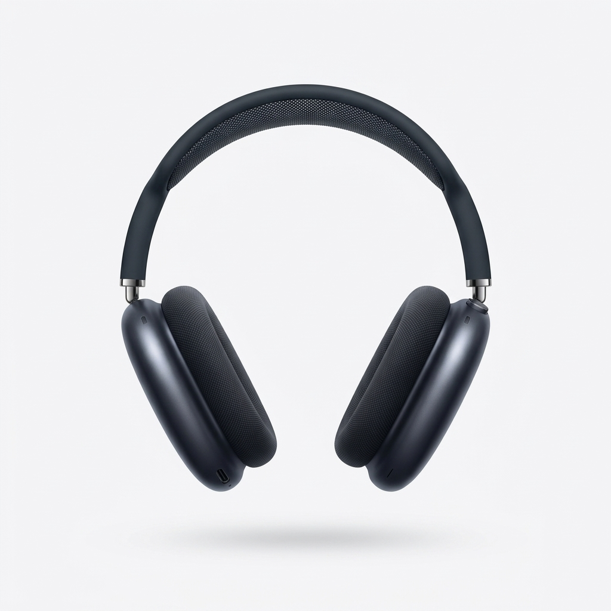
  </picture>

  <h1>Earprint</h1>
  <p>
    <strong>Turn Apple Health headphone listening history into interactive 3D collectible cards, a PSA-style Device Dossier, and 28-day Earprint Rings — 100% on-device for iPhone.</strong>
  </p>

  <p>
    <a href="https://apps.apple.com/app/id6837883616"></a>
    
    
    
    <a href="https://popcornnnnnnnn.github.io/earprint/privacy.html"></a>
    <a href="https://popcornnnnnnnn.github.io/earprint/support.html"></a>
  </p>

  <p>
    <a href="https://apps.apple.com/app/id6837883616">App Store</a> ·
    <a href="#interactive-3d-cards-in-motion">3D Cards</a> ·
    <a href="#key-features-v100">Features</a> ·
    <a href="#light--dark-mode-gallery">Screenshots</a> ·
    <a href="#build--test">Build &amp; Test</a> ·
    <a href="https://popcornnnnnnnn.github.io/earprint/">Website</a> ·
    <a href="https://popcornnnnnnnn.github.io/earprint/privacy.html">Privacy</a> ·
    <a href="https://popcornnnnnnnn.github.io/earprint/support.html">Support</a>
  </p>

  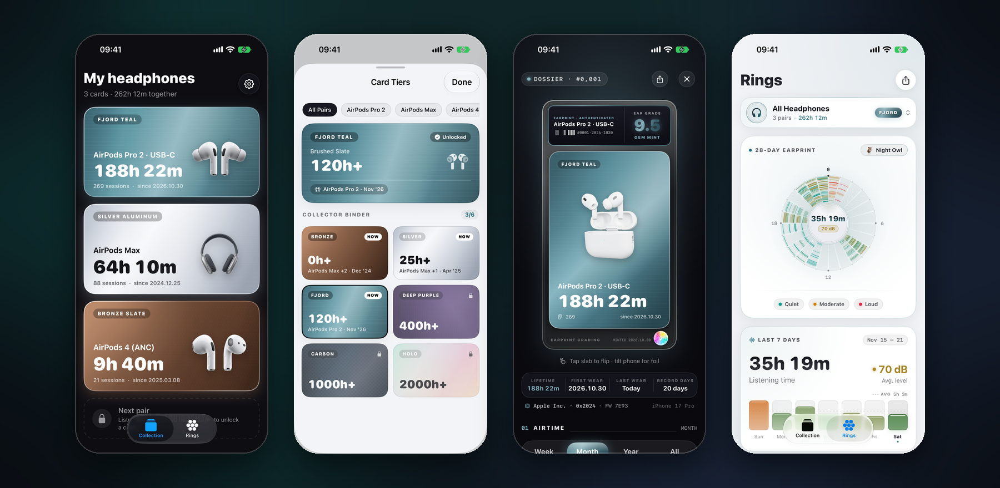
</div>

---

## Interactive 3D Cards in Motion

Every pair of headphones becomes a real-time **RealityKit** trading card floating above an anodized foil plate: drag to spin with momentum, pinch to zoom, long-press to twirl with haptics, tilt your phone for metallic specular shimmer and parallax, and tap or swipe to flip between the 3D showcase and lifetime stats.

<table>
  <tr>
    <th align="center">Dark Mode · AirPods Pro 2 (Fjord Teal)</th>
    <th align="center">Light Mode · AirPods Max (Silver Aluminum)</th>
  </tr>
  <tr>
    <td align="center">
      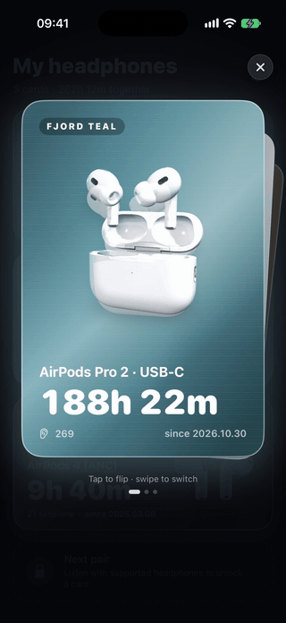
    </td>
    <td align="center">
      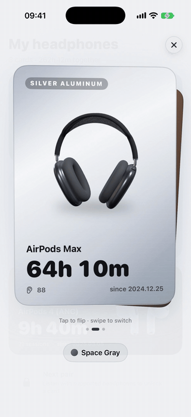
    </td>
  </tr>
</table>

---

## Key Features (v1.0.0)

- **6-Tier Rarity System & Collector Binder (`Earprint/Collection/`, `Earprint/ThreeD/`):**
  - Headphones automatically evolve across 6 curated foil tiers by lifetime listening hours:
    `Bronze Slate` (`0h+`) → `Silver Aluminum` (`25h+`) → `Fjord Teal` (`120h+`) → `Deep Purple` (`400h+`) → `Midnight Carbon` (`1,000h+`) → `Liquid Holo` (`2,000h+`).
  - Compact 2×3 multi-device Collector Binder highlights your highest achieved tier and records real unlock months computed directly from daily HealthKit listening history.
  - Persistent single-container RealityKit 3D rendering for smooth card-swipe transitions, plus finish selectors for AirPods Max and Beats models.
- **PSA-Style Device Dossier (`Earprint/Dossier/`):**
  - Flip any card and open its acoustic grading slab (`EAR GRADE` `1.0–10.0`) backed by real per-device Apple Health session history (`ListeningAggregate` v2).
  - Switch across `Week`, `Month`, `Year`, and `All`, scrub the 30-day trend bar chart, inspect the 24-hour radial Day Clock, review Habits & Hearing cards, browse milestone ETAs, and inspect the guilloché hardware provenance certificate.
- **28-Day Earprint Rings & WHO Hearing Budget (`Earprint/Home/`, `Earprint/Design/`):**
  - Plots the last `28 days × 24 hours` in a concentric local-time chronometer dial colored by energy-averaged loudness (`Leq` in `dB(A)`), paired with listening personas (`Night Owl`, `Commute Soundtracker`, `Early Bird`, `All-Day Listener`) and per-device filtering.
  - Tracks your weekly safe-listening budget against **WHO / ITU H.870** guidance (`80 dB(A)` for 40h/week, halving every `+3 dB`).
- **Global Light / Dark / System Theme & Bilingual UI (`Earprint/Design/`):**
  - Full Light, Dark, and System appearance switch in Settings across every view, Dossier slab, share poster, and widget.
  - Follows the iOS system language automatically by default (`English` & `简体中文`) across all screens—including the pre-permission Apple Health onboarding sheet and `InfoPlist.xcstrings`—and includes **41** selectable app icons in Settings.
- **Shareable Posters & Home/Lock Screen Widgets (`Earprint/Home/ShareCardView.swift`, `EarprintWidgets/`):**
  - Export crisp Light or Dark **`3:4`** and **`9:16`** Earprint Rings share posters, plus 1-page or 4-page Dossier carousel PNGs.
  - Native Home Screen widgets (`Today`, multi-card `Card Shelf` with `earprint://card/<id>` deep links, and `Large Earprint Ring`) plus Lock Screen `WHO Budget`, `Today`, and inline accessories.
- **100% On-Device Privacy (`Earprint/Data/`, `PrivacyInfo.xcprivacy`):**
  - Reads **only** `HKQuantityType(.headphoneAudioExposure)` in strict read-only mode (requests read-only access with `toShare: []` and never writes to Apple Health; `NSHealthUpdateUsageDescription` is included solely to satisfy App Store Connect's HealthKit validation).
  - Zero user accounts, zero servers, zero analytics or ad SDKs (`Data Not Collected`). Incremental `HKAnchoredObjectQueryDescriptor` sync runs off the main thread into an encrypted Application Support cache (`NSFileProtectionCompleteUntilFirstUserAuthentication`).

---

## Light & Dark Mode Gallery

<table>
  <tr>
    <th align="center">Collection · Dark Mode</th>
    <th align="center">Collection · Light Mode</th>
  </tr>
  <tr>
    <td align="center">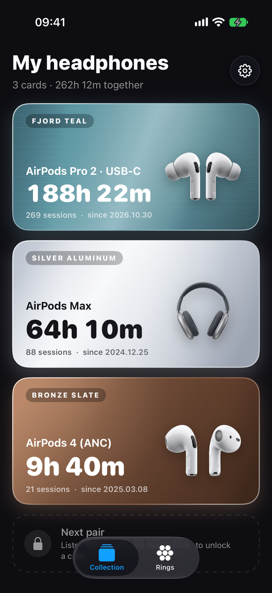</td>
    <td align="center">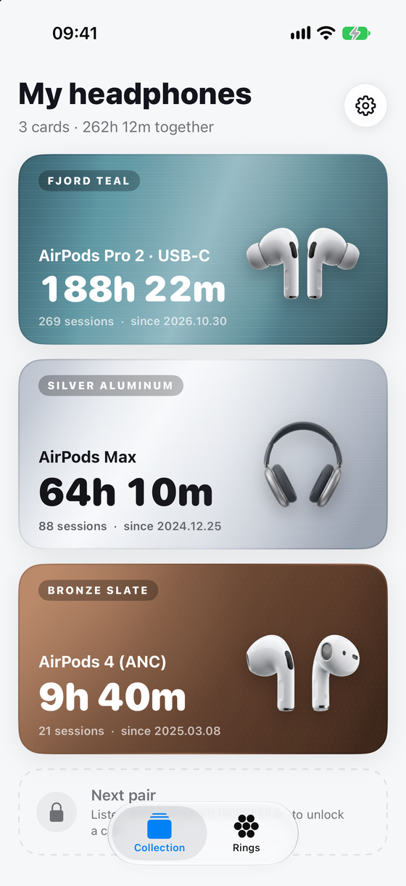</td>
  </tr>
  <tr>
    <th align="center">6-Tier Collector Binder · Light</th>
    <th align="center">6-Tier Collector Binder · Dark</th>
  </tr>
  <tr>
    <td align="center">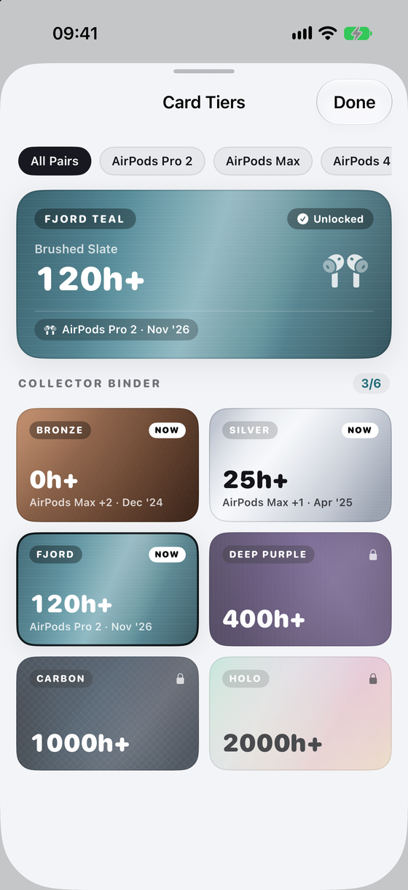</td>
    <td align="center">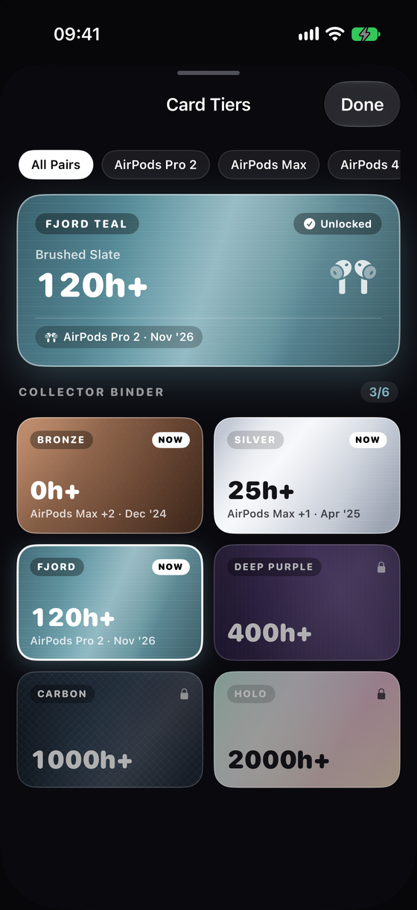</td>
  </tr>
  <tr>
    <th align="center">Device Dossier · Dark</th>
    <th align="center">Device Dossier · Light</th>
  </tr>
  <tr>
    <td align="center">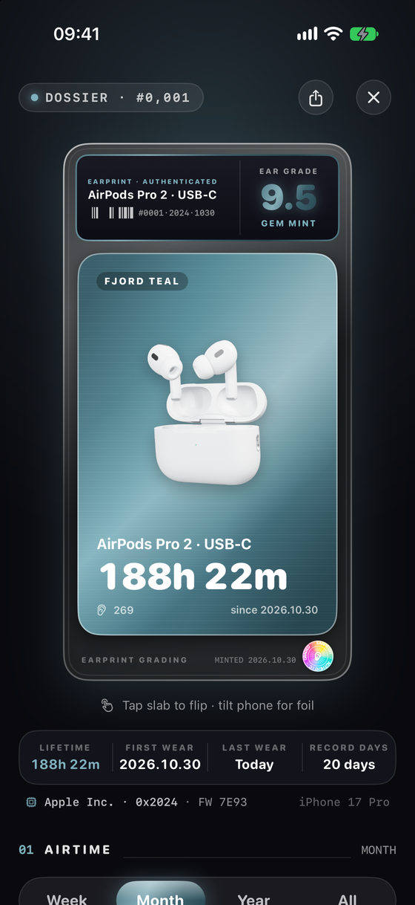</td>
    <td align="center">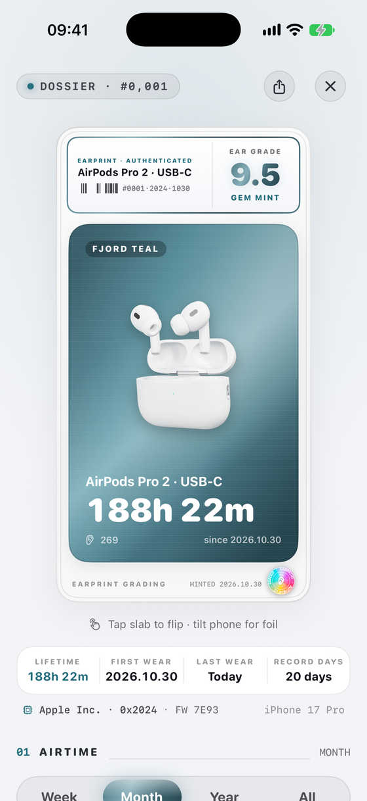</td>
  </tr>
</table>

<table>
  <tr>
    <th align="center">28-Day Rings · Dark</th>
    <th align="center">28-Day Rings · Light</th>
    <th align="center">3:4 Share Poster · Light</th>
  </tr>
  <tr>
    <td align="center">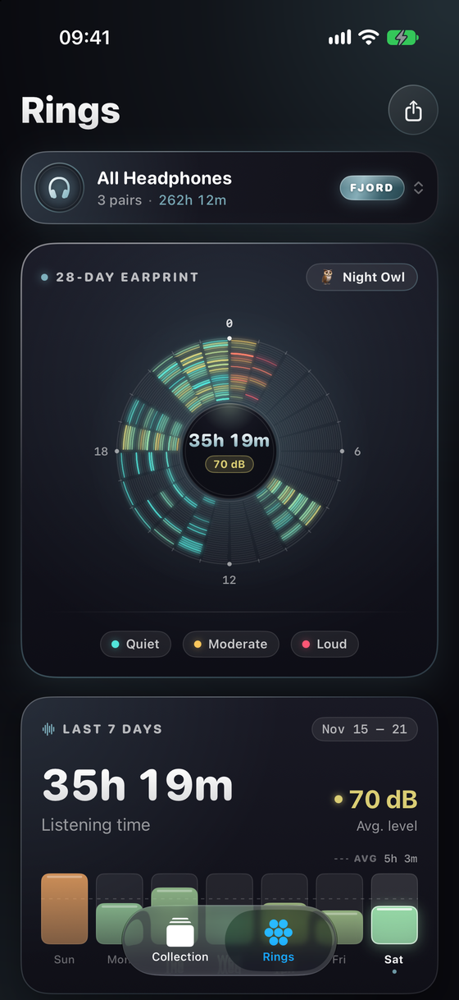</td>
    <td align="center">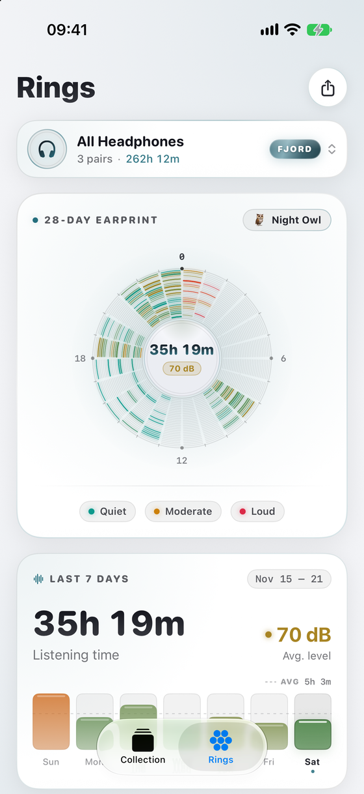</td>
    <td align="center">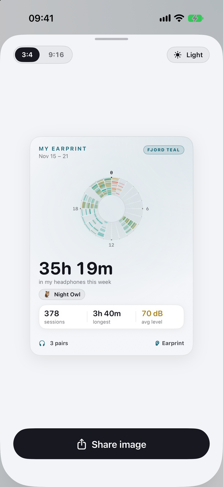</td>
  </tr>
</table>

---

## Build & Test

Requires Xcode 16+ (iOS 18+ SDK) and [XcodeGen](https://github.com/yonaskolb/XcodeGen).

```sh
# Regenerate Earprint.xcodeproj from project.yml (if modified)
xcodegen generate

# Run unit tests (70 tests in EarprintTests)
xcodebuild test -project Earprint.xcodeproj -scheme Earprint \
  -destination 'platform=iOS Simulator,name=iPhone 17 Pro' \
  -derivedDataPath build

# Generic iOS Release build & read-only Info.plist check
xcodebuild build -project Earprint.xcodeproj -scheme Earprint \
  -configuration Release -destination 'generic/platform=iOS' \
  CODE_SIGNING_ALLOWED=NO -derivedDataPath build

# Verify Release requests read-only HealthKit access and skips export compliance prompts
plutil -p build/Build/Products/Release-iphoneos/Earprint.app/Info.plist \
  | grep -E "NSHealth|ITSAppUsesNonExemptEncryption"
```

### Useful Debug Launch Arguments

- `-demo`, `-demoIndex <n>`, `-cardDetail`, `-cardHintOnce`
- `-cardTiers`, `-dossier`, `-rings`, `-showShare`
- `-appearance <light|dark>`, `-firstLaunch`, `-hideSampleBanner`
- `-tab <collection|rings|probe>`, `-seedHealth` (Debug Simulator only)

> On the Debug Simulator, press and hold the Settings gear icon in **Collection** for **Developer Tools → Data Probe**. For signed Release test builds that repeat the flip hint, add `SWIFT_ACTIVE_COMPILATION_CONDITIONS='$(inherited) EARPRINT_REPEAT_CARD_HINT'`.

### Project Architecture & Docs

- [3D Assets & Attribution Pipeline](docs/ASSETS.md)
- [HealthKit Pipeline & Device Catalog](docs/DATA.md)
- [Device Dossier Design](docs/DOSSIER.md)
- [Home & Lock Screen Widgets](docs/WIDGETS.md)
- [iPhone Duo Foldable Adaptation](docs/IPHONE_DUO.md)
- [Physical Device Acceptance Checklist (Issue #2)](https://github.com/Popcornnnnnnnn/earprint/issues/2)

---

## Privacy, Support & Credits

- **Website:** <https://popcornnnnnnnn.github.io/earprint/>
- **Privacy Policy:** <https://popcornnnnnnnn.github.io/earprint/privacy.html>
- **Support & FAQ:** <https://popcornnnnnnnn.github.io/earprint/support.html>
- **Contact:** Weizhi Wang (`wmax43906@gmail.com`)

### 3D Model Attributions (CC-BY 4.0)

| Bundled Asset | Source Title | Author | License & Modifications |
| --- | --- | --- | --- |
| `AirPods4.usdz` | [AirPods 4](https://sketchfab.com/3d-models/airpods-4-e44730974131402eb496352cab19c82e) | [Falah3D (`3dFalah`)](https://sketchfab.com/3dFalah) | [CC-BY 4.0](https://creativecommons.org/licenses/by/4.0/) · Decimated open pose, merged materials, normalized, texture-compressed, converted to USDZ |
| `AirPodsMax.usdz` | [Airpods max sky blue](https://sketchfab.com/3d-models/airpods-max-sky-blue-3d0643db08fc4ef89bda55a74077ece4) | [polyman Studio (`Polyman_3D`)](https://sketchfab.com/Polyman_3D) | [CC-BY 4.0](https://creativecommons.org/licenses/by/4.0/) · Decimated, joined meshes, baked PBR factors, canopy cutout opacity threshold, USDZ |
| `AirPodsPro.usdz` | [Airpods Pro With Magsafe Charging Case Ios15](https://sketchfab.com/3d-models/airpods-pro-with-magsafe-charging-case-ios15-52e5f28b37f94f05b6c0768773137689) | [polyman Studio (`Polyman_3D`)](https://sketchfab.com/Polyman_3D) | [CC-BY 4.0](https://creativecommons.org/licenses/by/4.0/) · Removed internal occlusion shell, decimated, merged materials, PBR baked, USDZ |
| `HeadphoneGeneric.usdz` | [Studio Headphones](https://sketchfab.com/3d-models/studio-headphones-2f04830fbf884632a89445db0d170ba8) | [crow (`crow.bite`)](https://sketchfab.com/crow.bite) | [CC-BY 4.0](https://creativecommons.org/licenses/by/4.0/) · Decimated, single-mesh normalized, baked roughness map, 2048 px compressed textures, USDZ |

See [docs/ASSETS.md](docs/ASSETS.md) for full provenance links and `AirPods4Credits.txt` details. In-app credits also ship in **Settings → Credits & Attributions**.

---

## Disclaimer

Earprint is an independent app developed by Weizhi Wang and is **not** affiliated with, sponsored by, or endorsed by Apple Inc. **Apple**, **Apple Health**, **AirPods**, **AirPods Pro**, **AirPods Max**, and **Beats** are trademarks of Apple Inc. Earprint visualizations, WHO weekly budget bars, and Ear Grade scores are for personal informational and collectible entertainment purposes only and are not a medical device.
