<div align="center">
  <picture>
    <source media="(prefers-color-scheme: dark)" srcset="Earprint/Assets.xcassets/AppIcon.appiconset/AppIcon-Dark.png">
    <source media="(prefers-color-scheme: light)" srcset="Earprint/Assets.xcassets/AppIcon.appiconset/AppIcon-Light.png">
    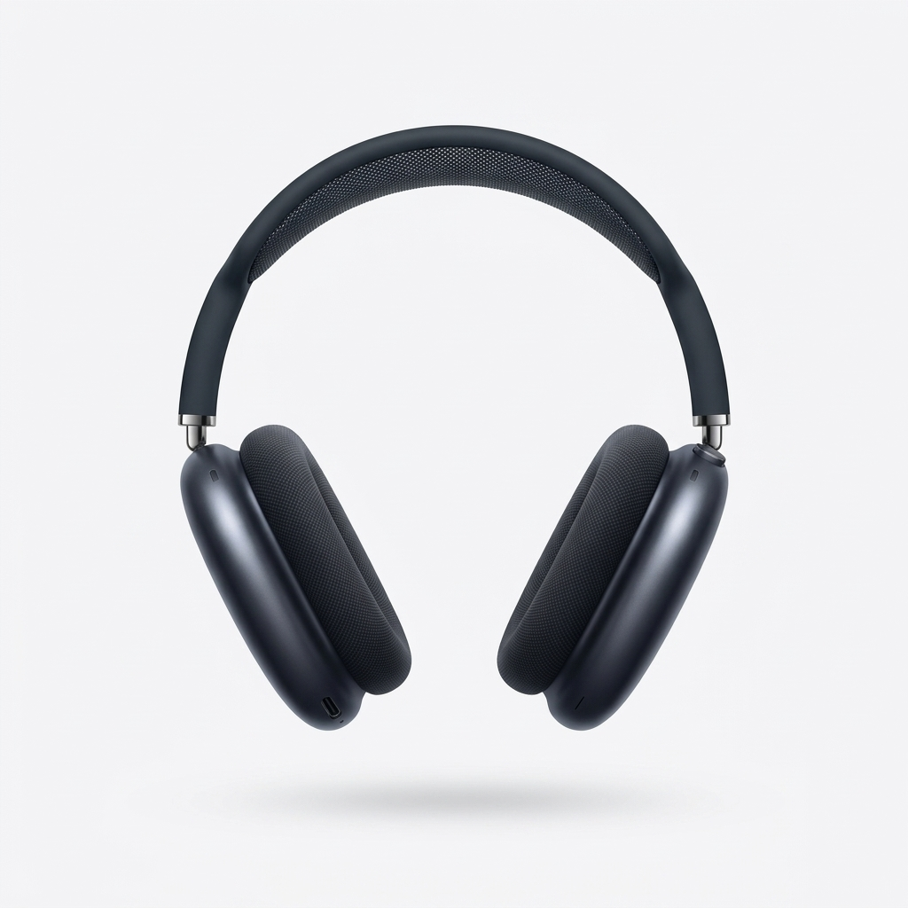
  </picture>

  <h1>Earprint</h1>
  <p>
    <strong>将 Apple 健康耳机聆听历史转化为可交互的 3D 收藏卡、PSA 风格设备档案与 28 天声纹圆环（Earprint Rings）——100% 本地运行于 iPhone。</strong>
  </p>

  <p>
    <a href="README.md">English</a> · <strong>简体中文</strong>
  </p>

  <p>
    <a href="https://apps.apple.com/app/id6837883616"></a>
    
    
    
    <a href="https://popcornnnnnnnn.github.io/earprint/privacy.html"></a>
    <a href="https://popcornnnnnnnn.github.io/earprint/support.html"></a>
  </p>

  <p>
    <a href="https://apps.apple.com/app/id6837883616">App Store</a> ·
    <a href="#动态交互-3d-卡片">3D 卡片</a> ·
    <a href="#核心功能-v100">核心功能</a> ·
    <a href="#浅色与深色模式图库">界面截图</a> ·
    <a href="#构建与测试">构建与测试</a> ·
    <a href="https://popcornnnnnnnn.github.io/earprint/">网站</a> ·
    <a href="https://popcornnnnnnnn.github.io/earprint/privacy.html">隐私政策</a> ·
    <a href="https://popcornnnnnnnn.github.io/earprint/support.html">支持</a>
  </p>

  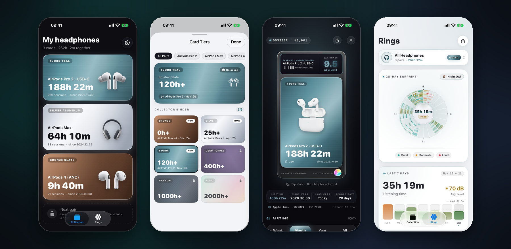
</div>

---

## 动态交互 3D 卡片

每一副耳机都会化身为漂浮在阳极氧化金属箔底板之上的实时 **RealityKit** 收藏卡：拖动即可带惯性旋转，双指捏合缩放，长按触发带触感反馈的旋转，倾斜手机感受金属高光与视差流动，轻点或滑动即可在 3D 展示面与累计聆听数据之间翻转切换。

<table>
  <tr>
    <th align="center">深色模式 · AirPods Pro 2（峡湾青）</th>
    <th align="center">浅色模式 · AirPods Max（银色铝金属）</th>
  </tr>
  <tr>
    <td align="center">
      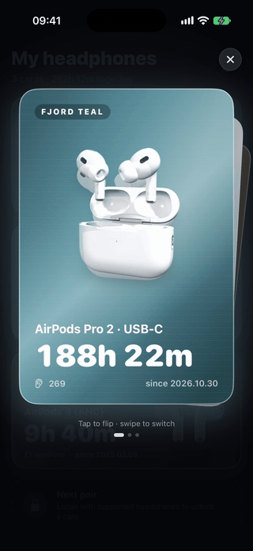
    </td>
    <td align="center">
      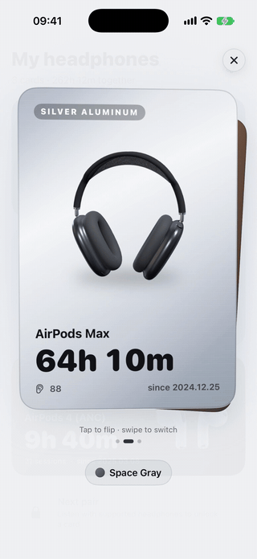
    </td>
  </tr>
</table>

---

## 核心功能 v1.0.0

- **6 级稀有度体系与收藏册（`Earprint/Collection/`、`Earprint/ThreeD/`）：**
  - 耳机随累计聆听时长自动在 6 个精选金属箔等级间进化：
    `Bronze Slate`（`0h+`）→ `Silver Aluminum`（`25h+`）→ `Fjord Teal`（`120h+`）→ `Deep Purple`（`400h+`）→ `Midnight Carbon`（`1,000h+`）→ `Liquid Holo`（`2,000h+`）。
  - 紧凑的 2×3 多设备收藏册突出展示你达到的最高等级，并记录直接从每日 HealthKit 聆听历史中计算出的真实解锁月份。
  - 持久化单容器 RealityKit 3D 渲染保障卡片滑动切换顺滑流畅，并为 AirPods Max 与 Beats 型号提供外观配色选择器。
- **PSA 风格设备档案（`Earprint/Dossier/`）：**
  - 翻转任意卡片即可打开由真实分设备 Apple 健康会话历史（`ListeningAggregate` v2）驱动的声学评级卡盒（`EAR GRADE` `1.0–10.0`）。
  - 支持在 `周`、`月`、`年` 与 `全部` 之间切换，拖动查看 30 天趋势柱状图、检查 24 小时径向时间轮、浏览习惯与听力卡片、查看里程碑预计达成时间，以及端详玑镂纹硬件溯源证书。
- **28 天声纹圆环与 WHO 听力预算（`Earprint/Home/`、`Earprint/Design/`）：**
  - 在同心本地时间表盘中绘制最近 `28 天 × 24 小时` 的聆听分布，并以能量平均响度（`Leq`，单位 `dB(A)`）着色，搭配聆听画像标签（`夜猫子`、`通勤声景家`、`早起鸟`、`全天候聆听者`）与分设备筛选。
  - 对照 **WHO / ITU H.870** 指南（`80 dB(A)` 下每周 40 小时，每增加 `+3 dB` 安全时长减半）追踪你的每周安全聆听预算。
- **全局浅色 / 深色 / 跟随系统主题与双语界面（`Earprint/Design/`）：**
  - 在设置中一键切换浅色、深色或跟随系统外观，覆盖所有页面、设备档案卡盒、分享海报与小组件。
  - 默认自动跟随 iOS 系统语言（`English` 与 `简体中文`），覆盖包括 Apple 健康权限前导引导页和 `InfoPlist.xcstrings` 在内的所有界面，并在设置中内置 **41** 款可选应用图标。
- **可分享海报与主屏/锁屏小组件（`Earprint/Home/ShareCardView.swift`、`EarprintWidgets/`）：**
  - 导出高清浅色或深色 **`3:4`** 与 **`9:16`** 声纹圆环分享海报，以及单页或四页设备档案轮播 PNG 图片。
  - 原生主屏幕小组件（`今日概览`、支持 `earprint://card/<id>` 深链的多卡 `Card Shelf` 与 `大号声纹圆环`）以及锁屏 `WHO 预算`、`今日` 与行内小组件。
- **100% 本地隐私保护（`Earprint/Data/`、`PrivacyInfo.xcprivacy`）：**
  - 严格以只读方式**仅**读取 `HKQuantityType(.headphoneAudioExposure)`（以 `toShare: []` 请求只读权限，绝不向 Apple 健康写入数据；保留 `NSHealthUpdateUsageDescription` 仅用于满足 App Store Connect 的 HealthKit 校验要求）。
  - 零用户账号、零服务器、零统计或广告 SDK（`不收集数据`）。通过 `HKAnchoredObjectQueryDescriptor` 在后台线程进行增量同步，写入受系统保护的 Application Support 加密缓存（`NSFileProtectionCompleteUntilFirstUserAuthentication`）。

---

## 浅色与深色模式图库

<table>
  <tr>
    <th align="center">收藏架 · 深色模式</th>
    <th align="center">收藏架 · 浅色模式</th>
  </tr>
  <tr>
    <td align="center">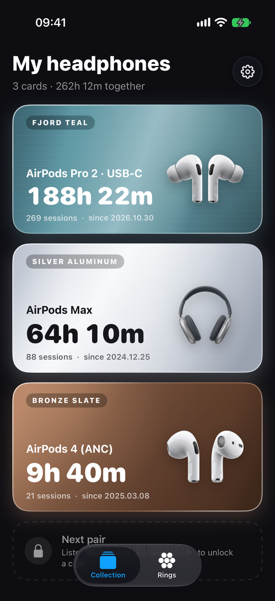</td>
    <td align="center">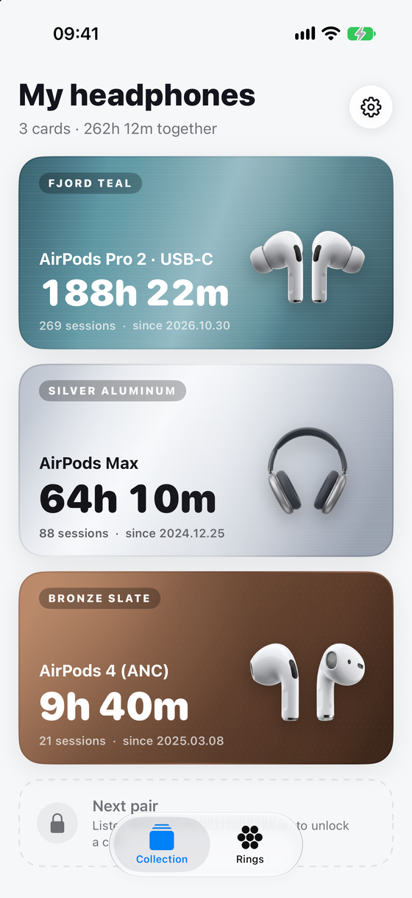</td>
  </tr>
  <tr>
    <th align="center">6 级收藏册 · 浅色</th>
    <th align="center">6 级收藏册 · 深色</th>
  </tr>
  <tr>
    <td align="center">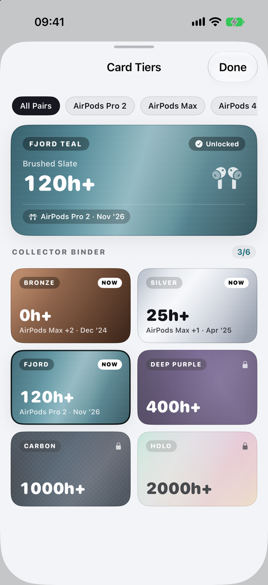</td>
    <td align="center">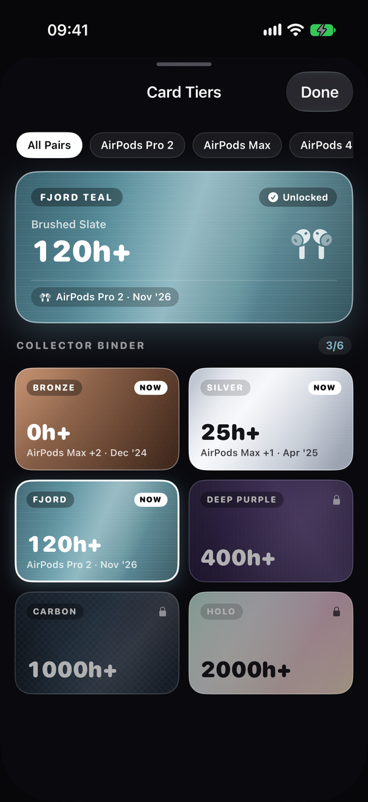</td>
  </tr>
  <tr>
    <th align="center">设备档案 · 深色</th>
    <th align="center">设备档案 · 浅色</th>
  </tr>
  <tr>
    <td align="center">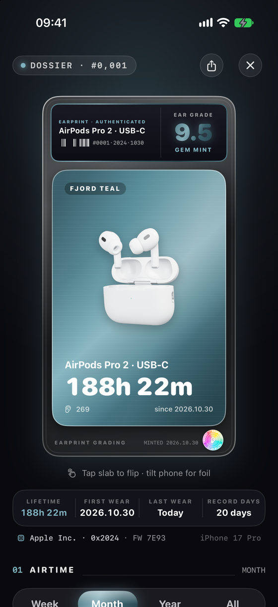</td>
    <td align="center">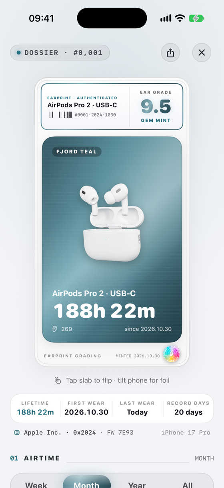</td>
  </tr>
</table>

<table>
  <tr>
    <th align="center">28 天声纹圆环 · 深色</th>
    <th align="center">28 天声纹圆环 · 浅色</th>
    <th align="center">3:4 分享海报 · 浅色</th>
  </tr>
  <tr>
    <td align="center">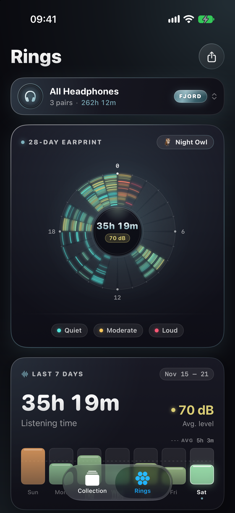</td>
    <td align="center">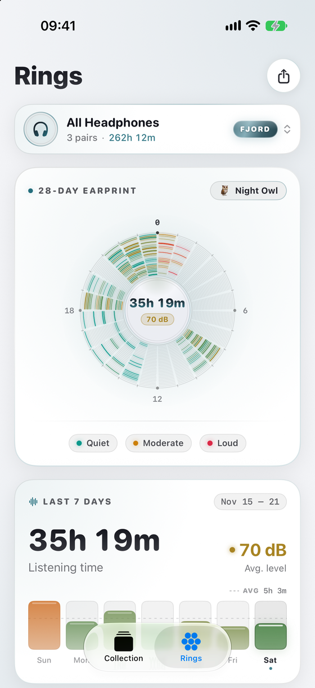</td>
    <td align="center">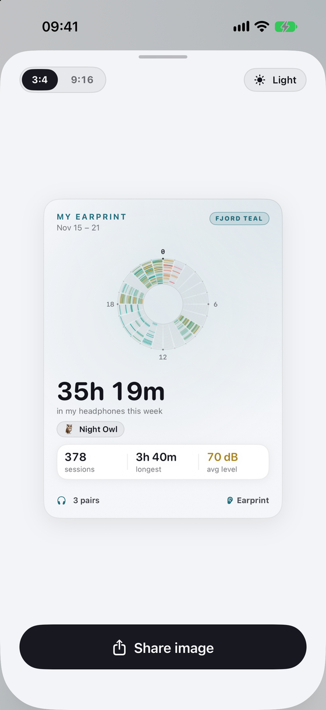</td>
  </tr>
</table>

---

## 构建与测试

需要 Xcode 16+（iOS 18+ SDK）与 [XcodeGen](https://github.com/yonaskolb/XcodeGen)。

```sh
# 根据 project.yml 重新生成 Earprint.xcodeproj（如已修改）
xcodegen generate

# 运行单元测试（EarprintTests 中共 70 项测试）
xcodebuild test -project Earprint.xcodeproj -scheme Earprint \
  -destination 'platform=iOS Simulator,name=iPhone 17 Pro' \
  -derivedDataPath build

# 通用 iOS Release 构建与只读 Info.plist 检查
xcodebuild build -project Earprint.xcodeproj -scheme Earprint \
  -configuration Release -destination 'generic/platform=iOS' \
  CODE_SIGNING_ALLOWED=NO -derivedDataPath build

# 验证 Release 构建仅请求只读 HealthKit 权限并跳过出口合规提示
plutil -p build/Build/Products/Release-iphoneos/Earprint.app/Info.plist \
  | grep -E "NSHealth|ITSAppUsesNonExemptEncryption"
```

### 常用调试启动参数

- `-demo`、`-demoIndex <n>`、`-cardDetail`、`-cardHintOnce`
- `-cardTiers`、`-dossier`、`-rings`、`-showShare`
- `-appearance <light|dark>`、`-firstLaunch`、`-hideSampleBanner`
- `-tab <collection|rings|probe>`、`-seedHealth`（仅 Debug 模拟器可用）

> 在 Debug 模拟器中，长按 **收藏架** 里的设置齿轮图标即可进入 **开发者工具 → 数据探针（Data Probe）**。若要在已签名的 Release 测试构建中重复展示翻转提示，可添加 `SWIFT_ACTIVE_COMPILATION_CONDITIONS='$(inherited) EARPRINT_REPEAT_CARD_HINT'`。

### 项目架构与文档

- [3D 资源与署名管线](docs/ASSETS.md)
- [HealthKit 管线与设备目录](docs/DATA.md)
- [设备档案设计](docs/DOSSIER.md)
- [主屏与锁屏小组件](docs/WIDGETS.md)
- [iPhone Duo 折叠形态适配](docs/IPHONE_DUO.md)
- [真机验收清单（Issue #2）](https://github.com/Popcornnnnnnnn/earprint/issues/2)

---

## 隐私、支持与致谢

- **网站：** <https://popcornnnnnnnn.github.io/earprint/>
- **隐私政策：** <https://popcornnnnnnnn.github.io/earprint/privacy.html>
- **支持与常见问题：** <https://popcornnnnnnnn.github.io/earprint/support.html>
- **联系作者：** Weizhi Wang（`wmax43906@gmail.com`）

### 3D 模型署名（CC-BY 4.0）

| 内置资源 | 原作品名称 | 作者 | 协议与修改说明 |
| --- | --- | --- | --- |
| `AirPods4.usdz` | [AirPods 4](https://sketchfab.com/3d-models/airpods-4-e44730974131402eb496352cab19c82e) | [Falah3D (`3dFalah`)](https://sketchfab.com/3dFalah) | [CC-BY 4.0](https://creativecommons.org/licenses/by/4.0/) · 减面为开盖姿态、合并材质、归一化、纹理压缩、转换为 USDZ |
| `AirPodsMax.usdz` | [Airpods max sky blue](https://sketchfab.com/3d-models/airpods-max-sky-blue-3d0643db08fc4ef89bda55a74077ece4) | [polyman Studio (`Polyman_3D`)](https://sketchfab.com/Polyman_3D) | [CC-BY 4.0](https://creativecommons.org/licenses/by/4.0/) · 减面、合并网格、烘焙 PBR 参数、网罩镂空透明度阈值、USDZ |
| `AirPodsPro.usdz` | [Airpods Pro With Magsafe Charging Case Ios15](https://sketchfab.com/3d-models/airpods-pro-with-magsafe-charging-case-ios15-52e5f28b37f94f05b6c0768773137689) | [polyman Studio (`Polyman_3D`)](https://sketchfab.com/Polyman_3D) | [CC-BY 4.0](https://creativecommons.org/licenses/by/4.0/) · 移除内部遮挡壳体、减面、合并材质、PBR 烘焙、USDZ |
| `HeadphoneGeneric.usdz` | [Studio Headphones](https://sketchfab.com/3d-models/studio-headphones-2f04830fbf884632a89445db0d170ba8) | [crow (`crow.bite`)](https://sketchfab.com/crow.bite) | [CC-BY 4.0](https://creativecommons.org/licenses/by/4.0/) · 减面、单网格归一化、烘焙粗糙度贴图、2048 px 压缩纹理、USDZ |

完整溯源链接与 `AirPods4Credits.txt` 详情请参阅 [docs/ASSETS.md](docs/ASSETS.md)。应用内的 **设置 → 致谢与署名** 中也内置了相关署名信息。

---

## 免责声明

Earprint 是由 Weizhi Wang 独立开发的应用程序，与 Apple Inc.**没有**任何关联、赞助或背书关系。**Apple**、**Apple 健康**、**AirPods**、**AirPods Pro**、**AirPods Max** 与 **Beats** 均为 Apple Inc. 的商标。Earprint 的可视化图表、WHO 每周预算条与 Ear Grade 评分仅用于个人参考和收藏娱乐目的，并非医疗器械。
