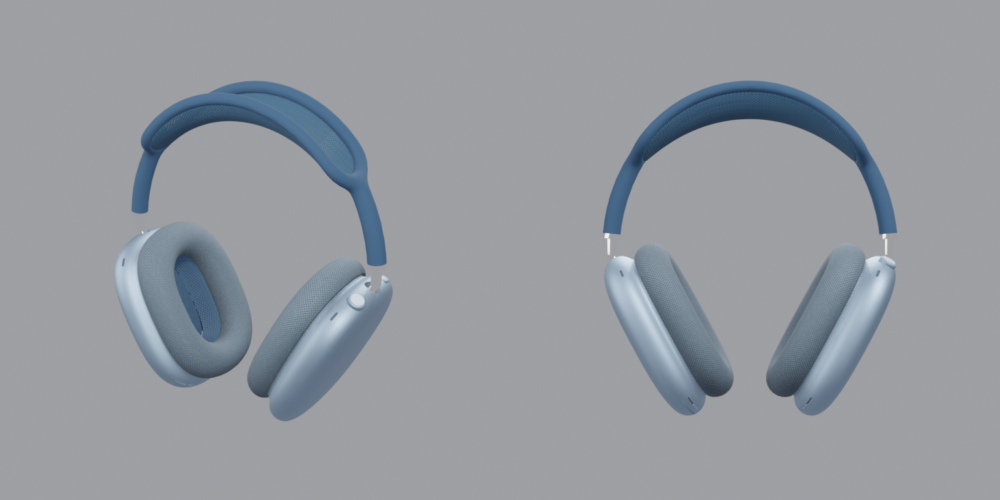
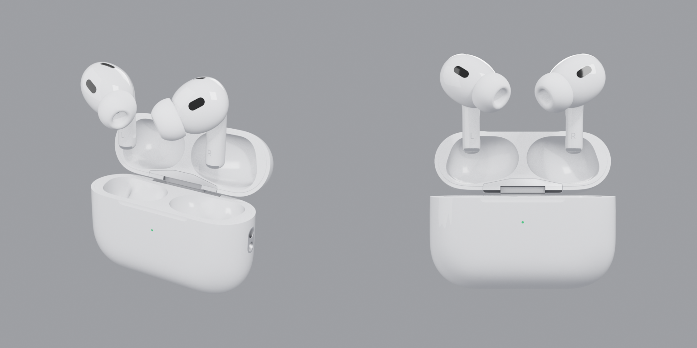
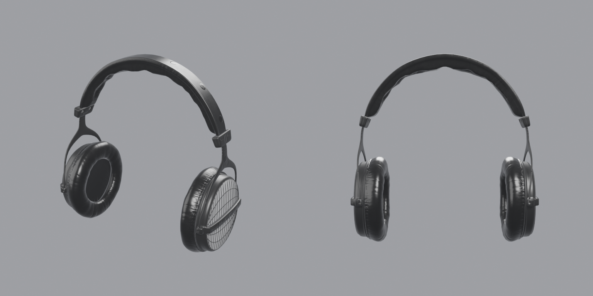
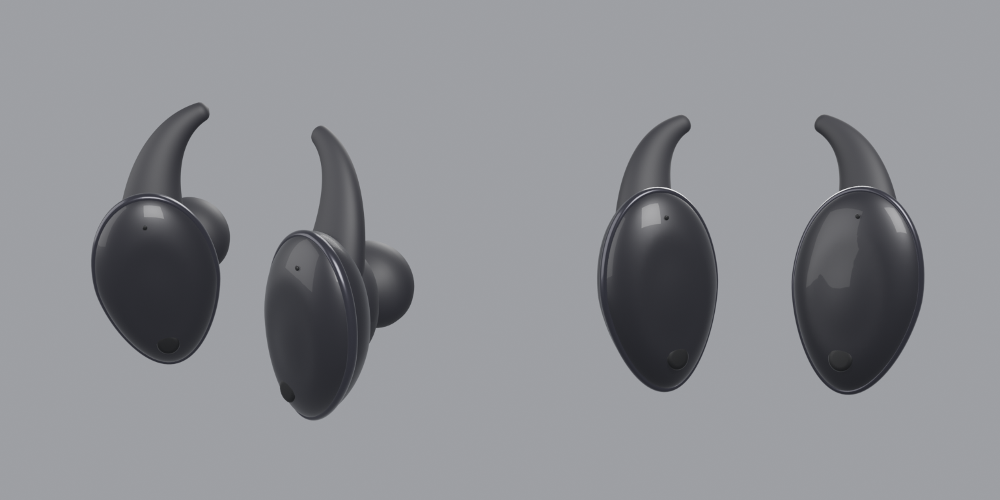
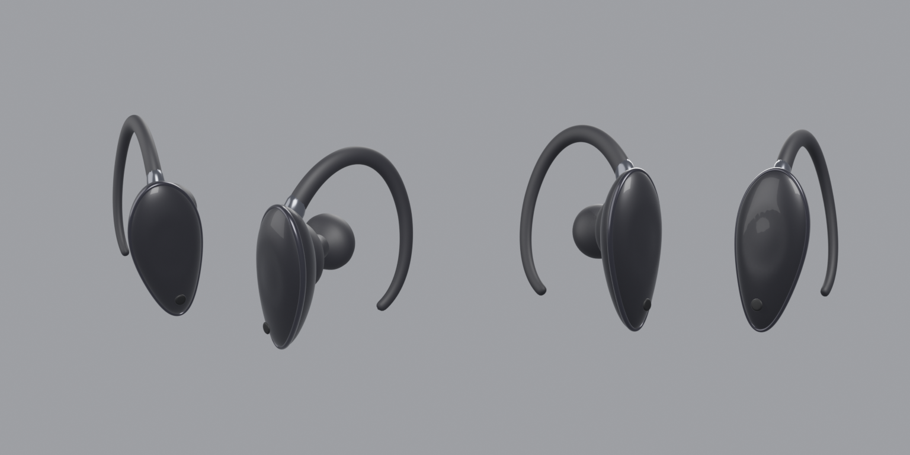
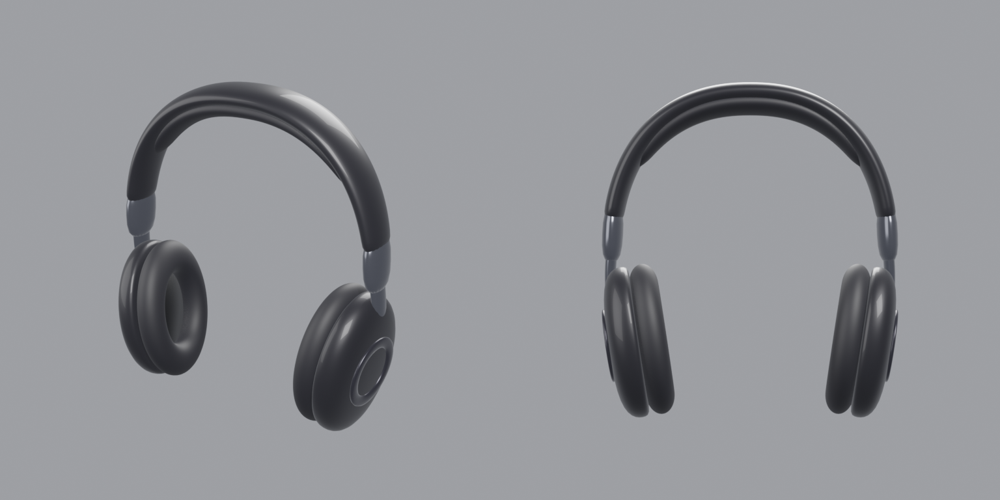

# 3D Headphone Assets & Attribution

Earprint bundles seven optimized `.usdz` models in `Earprint/Resources/Models/` for interactive RealityKit display inside headphone collection cards (iOS 18+). Each model is normalized to unit bounding size (largest dimension = `1.0`, centered at the origin, Y-up, facing `+Z`) and verified with `usdchecker` and live iOS Simulator RealityKit rendering.

## Collectible support

| Identified product family | Card artwork | Interactive 3D |
| --- | --- | --- |
| AirPods (1st and 2nd generation), AirPods 3, and mapped AirPods 5 variants | Shared open-ear AirPods artwork | Card tilt and flip |
| AirPods 4 and AirPods 4 (ANC) | Earbuds alone in Collection. Earbuds with the open charging case in detail. | Shared AirPods 4 USDZ model with the open case |
| AirPods Pro 1, 2 (Lightning and USB-C), and 3 | Shared AirPods Pro artwork | Shared AirPods Pro USDZ model |
| AirPods Max (Lightning, USB-C) and AirPods Max 2 | Shared AirPods Max artwork and finish choices | Shared AirPods Max USDZ model |
| Beats earbuds (Fit Pro, Studio Buds / +, Solo Buds, Powerbeats Fit, Beats Flex, BeatsX) | Sculpted wingtip earbud artwork and finish choices | Original procedural Blender USDZ (`BeatsBuds.usdz`) with per-zone PBR finish support |
| Powerbeats earhook (Powerbeats Pro, Pro 2, Powerbeats, Powerbeats3) | Sport earbud artwork and finish choices | Original procedural Blender USDZ (`BeatsEarhook.usdz`) with per-zone PBR finish support |
| Beats over-ear (Studio Pro, Solo 4, Studio3, Solo Pro, Solo3) | Custom closed-back over-ear artwork and finish choices | Original procedural Blender USDZ (`BeatsOverEar.usdz`) with per-zone PBR finish support |

Generation names come from the HealthKit product catalog. Artwork and interactive models are shared within their listed families. Other third-party devices use generic fallback geometry/previews (`HeadphoneGeneric.usdz` / `ProceduralHeadphones`) while staying in the listening history.

## Attribution Table (CC-BY 4.0)

| Bundled Asset | Source Title | Author | Source URL | License | Polycount (Raw → Final) | File Size | Max Texture | Modifications Made |
| --- | --- | --- | --- | --- | --- | --- | --- | --- |
| `AirPods4.usdz` | AirPods 4 | [Falah3D (`3dFalah`)](https://sketchfab.com/3dFalah) | [Sketchfab](https://sketchfab.com/3d-models/airpods-4-e44730974131402eb496352cab19c82e) | [CC-BY 4.0](https://creativecommons.org/licenses/by/4.0/) | 99,248 → 44,967 tris | 4.67 MiB (4,893,562 B) | 1024 px | Decimated the original open pose; joined meshes by material; centered and normalized (Y-up, +Z); compressed opaque textures; converted FBX to USDZ. |
| `AirPodsMax.usdz` | Airpods max sky blue | [polyman Studio (`Polyman_3D`)](https://sketchfab.com/Polyman_3D) | [Sketchfab](https://sketchfab.com/3d-models/airpods-max-sky-blue-3d0643db08fc4ef89bda55a74077ece4) | [CC-BY 4.0](https://creativecommons.org/licenses/by/4.0/) | 87,701 → 41,968 tris | 5.51 MB (5,777,710 B) | 1024 px | Decimated to ~42k tris; removed unused UV channels; joined meshes per material (137 → 20); centered & normalized (Y-up, +Z); baked glTF PBR metallic/roughness factors; dropped baked emissive maps; JPEG-compressed opaque textures (q85); added `opacityThreshold = 0.5` on knit headband canopy cutout materials; converted glTF → USDZ. |
| `AirPodsPro.usdz` | Airpods Pro With Magsafe Charging Case Ios15 | [polyman Studio (`Polyman_3D`)](https://sketchfab.com/Polyman_3D) | [Sketchfab](https://sketchfab.com/3d-models/airpods-pro-with-magsafe-charging-case-ios15-52e5f28b37f94f05b6c0768773137689) | [CC-BY 4.0](https://creativecommons.org/licenses/by/4.0/) | 96,992 → 47,975 tris | 3.95 MB (4,139,743 B) | 1024 px | Removed internal black occlusion shell (`rfmqyaJLfjAyTkY`) that poked through after decimation; decimated to ~48k tris; joined meshes per material (48 → 14); centered & normalized (Y-up, +Z); baked glTF `metallicFactor = 0` so glossy white plastic exports accurately to `UsdPreviewSurface`; dropped baked emissive maps; JPEG-compressed opaque textures (q88); converted glTF → USDZ. |
| `HeadphoneGeneric.usdz` | Studio Headphones | [crow (`crow.bite`)](https://sketchfab.com/crow.bite) | [Sketchfab](https://sketchfab.com/3d-models/studio-headphones-2f04830fbf884632a89445db0d170ba8) | [CC-BY 4.0](https://creativecommons.org/licenses/by/4.0/) | 64,544 → 51,995 tris | 4.68 MB (4,902,775 B) | 2048 px | Decimated to ~52k tris; joined 6 parts into 1 mesh; centered & normalized (Y-up, +Z); baked glTF `roughnessFactor` into metallic-roughness map; downscaled 4096 px textures to 2048 px and JPEG-compressed opaque maps (q90); converted glTF → USDZ. |

The AirPods 4 card artwork uses Falah3D’s published front render, cropped and masked to remove the background. The model uses the [FBX and textures redistributed by Andrea Balbo](https://github.com/andre94/clawd-airpods4-anc-case/tree/0a7b262a535ec8239ec12de62d506d94d206db8b/assets/reference/airpods-4) with [recorded provenance](https://github.com/andre94/clawd-airpods4-anc-case/blob/0a7b262a535ec8239ec12de62d506d94d206db8b/THIRD_PARTY_NOTICES.md#airpods-4-visual-reference--falah3d). Earprint bundles the credit notice in `AirPods4Credits.txt`.

### Required CC-BY 4.0 Credit Text

- This work is based on [*AirPods 4*](https://sketchfab.com/3d-models/airpods-4-e44730974131402eb496352cab19c82e) by [Falah3D](https://sketchfab.com/3dFalah), licensed under [CC BY 4.0](https://creativecommons.org/licenses/by/4.0/).
- This work is based on *"Airpods max sky blue"* (<https://sketchfab.com/3d-models/airpods-max-sky-blue-3d0643db08fc4ef89bda55a74077ece4>) by **polyman Studio** (<https://sketchfab.com/Polyman_3D>) licensed under **CC-BY 4.0** (<https://creativecommons.org/licenses/by/4.0/>).
- This work is based on *"Airpods Pro With Magsafe Charging Case Ios15"* (<https://sketchfab.com/3d-models/airpods-pro-with-magsafe-charging-case-ios15-52e5f28b37f94f05b6c0768773137689>) by **polyman Studio** (<https://sketchfab.com/Polyman_3D>) licensed under **CC-BY 4.0** (<https://creativecommons.org/licenses/by/4.0/>).
- This work is based on *"Studio Headphones"* (<https://sketchfab.com/3d-models/studio-headphones-2f04830fbf884632a89445db0d170ba8>) by **crow** (<https://sketchfab.com/crow.bite>) licensed under **CC-BY 4.0** (<https://creativecommons.org/licenses/by/4.0/>).

## Rendered Previews

Each preview shows a 3/4 hero angle (left) and straight `+Z` front view (right), re-imported from the final `.usdz` via `tools/assets/render_preview.py`:

- **AirPodsMax.usdz** — 
- **AirPodsPro.usdz** — 
- **HeadphoneGeneric.usdz** — 
- **BeatsBuds.usdz** — 
- **BeatsEarhook.usdz** — 
- **BeatsOverEar.usdz** — 

## Reproducing the Pipeline

Raw downloads stay in `assets-raw/` (gitignored). To rebuild the optimized USDZ files with Blender 5.2+ and macOS USD tools (`usdcat`, `usdzip`, `sips`):

```bash
BLENDER="/Applications/Blender.app/Contents/MacOS/Blender"

"$BLENDER" -b --factory-startup -P tools/assets/process_model.py -- \
  --in "$PWD/assets-raw/airpods4/source/AirPods 4.fbx" \
  --out "$PWD/Earprint/Resources/Models/AirPods4.usdz" \
  --target-tris 45000 --max-tex 1024 --join-by-material --jpeg-opaque --jpeg-quality 88

"$BLENDER" -b --factory-startup -P tools/assets/process_model.py -- \
  --in assets-raw/airpods-max/scene.gltf \
  --out Earprint/Resources/Models/AirPodsMax.usdz \
  --target-tris 42000 --max-tex 1024 --drop-emissive \
  --join-by-material --jpeg-opaque --jpeg-quality 85 \
  --cutout '^(DeFxnmzQHJkzqmx|DpauuenuPBdCvhC)$'

"$BLENDER" -b --factory-startup -P tools/assets/process_model.py -- \
  --in assets-raw/airpods-pro/scene.gltf \
  --out Earprint/Resources/Models/AirPodsPro.usdz \
  --target-tris 48000 --max-tex 1024 --drop-emissive \
  --exclude '^rfmqyaJLfjAyTkY$' \
  --join-by-material --jpeg-opaque --jpeg-quality 88

"$BLENDER" -b --factory-startup -P tools/assets/process_model.py -- \
  --in assets-raw/studio-headphones/scene.gltf \
  --out Earprint/Resources/Models/HeadphoneGeneric.usdz \
  --target-tris 52000 --max-tex 2048 --drop-emissive \
  --join-by-material --jpeg-opaque --jpeg-quality 90
```

## Trademark & Distribution Notice

- **Apple**, **AirPods**, **AirPods Max**, **AirPods Pro**, and **MagSafe** are trademarks of Apple Inc., registered in the U.S. and other countries.
- Earprint is an independent project and is not affiliated with, sponsored by, or endorsed by Apple Inc.
- The CC-BY 4.0 licenses above grant copyright permission for the 3D geometry and textures created by their respective Sketchfab authors, **not** trademark rights in third-party product designs or trade dress. Before any public App Store distribution, review trademark/trade-dress compliance (and note that `Earprint/ThreeD/HeadphoneModel.swift` retains original procedural fallback models in `ProceduralHeadphones` if any bundled USDZ is removed).
