# Device Dossier

The **Device Dossier** is the deep-dive view for a single headphone card in Earprint. Rather than a generic analytics dashboard, it treats each pair of headphones as an authenticated collectible sealed in a **PSA-style acrylic grading slab**, backed by an editorial case-file breakdown of listening time, daily rhythm, hearing habits, milestones, and hardware provenance.

<p align="center">
  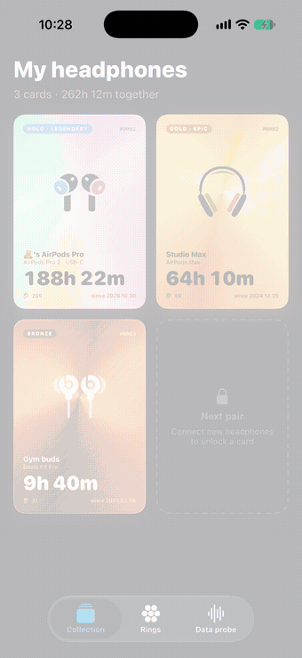
</p>

## Entry Points

- **Card Detail (`CollectionView.swift`)**: Tap the foil **Dossier** pill button next to **Share card** / **Close**, or **swipe up** on the card detail view.
- **Launch arguments (Simulator / QA)**:
  - `-dossier` — opens the dossier directly on launch (combine with `-demoIndex <n>` to pick a card; defaults to `0`).
  - `-dossierPeriod <week|month|year|all>` — selects the initial period window.
  - `-dossierScroll <section>` — jumps directly to a section (`slab`, `airtime`, `charts`, `clock`, `habits`, `lifetime`, `milestones`, `certificate`, `grade`).
  - `-dossierDemo` — auto-plays slab tilt shimmer, period switching (`Week` / `Month` / `Year` / `All`), 30-day bar scrubbing, and scrolling for demo capture.
  - `-cardDetail` — opens `CardDetail` directly to inspect the Dossier entry button.

## Design Structure

Every dossier inherits its card's rarity palette (**Holo**, **Gold**, **Silver**, **Bronze**) across foil surfaces, ambient glow, active pills, ring arcs, and milestone accents.

| # | Section | What It Shows |
|---|---|---|
| Top | **Sticky Header & Grading Slab** | Clear acrylic slab holding the live `CardFront`/`CardBack` (tap to flip, tilt phone for specular shimmer), cert header with barcode & **Ear Grade** (`0.0–10.0`), spinning `HoloSeal`, lifetime quick strip (Lifetime, First Wear, Last Wear, Record Days), and hardware summary (`Apple Inc. · 0x2024 · FW 7E93`). Scrolling past the slab morphs the top bar into a compact sticky identity pill with tap-to-top and grade badge. |
| `01` | **Airtime** | Sliding foil `PeriodSwitcher` (`Week` / `Month` / `Year` / `All`, tap or swipe) with `.contentTransition(.numericText())`, watch-bezel `AirtimeHero` duration ring whose filled arc is this device's **wear share** against all other headphones, and a 3-column summary bar (daily avg, delta vs previous window or wear count, days worn). |
| `02` | **Rhythm** | Interactive **Swift Charts** `DossierTrendChart` (drag to scrub with haptic ticks, loudness-colored gradient bars, average dashed rule, `MINTED` marker, best-bucket crown) paired with a 24-hour radial **`DayClock`** (tap or long-press-drag any hour; day/night outer track, loudness coloring, late-night share badge). |
| `03` | **Habits & Hearing** | 6-tile `HabitsBento` (Wears w/ tally marks, Avg per wear w/ ratio ring, Longest single wear w/ `EST.` badge and 24-hour `SessionTrack`, Average volume w/ 40–100 dB(A) `LoudnessMeter` & WHO weekly dose, Days worn w/ `DayDots` matrix, Wears a day w/ `Sparkline`) followed by a **Lifetime Ledger** (first/last wear timestamps + baseball-card monthly `careerRows`). |
| `04` | **Milestones** | Chronological vertical timeline: Minted (`BRONZE`), hour milestones (`10h`, `50h`, `100h`, `200h`, `500h`, `1000h`, `2000h`), tier upgrades (`Silver`, `Gold`, `Holo`), Longest Wear, Biggest Day, and an upcoming goal with pace-based **ETA**. |
| `05` | **Certificate & Grade** | Guilloché-patterned `CertificateLabel` displaying full `HKDevice`/`HKSource` provenance, barcode, and `HoloSeal`, followed by the transparent **How It's Graded** penalty breakdown. |

### Screen Tour

| Entry (`CardDetail`) | Grading Slab (Holo) | Grading Slab (Gold) |
|---|---|---|
| 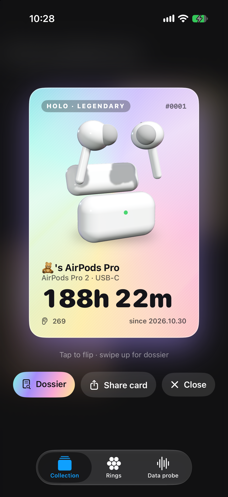 | 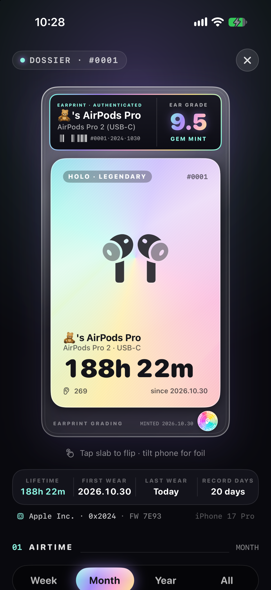 | 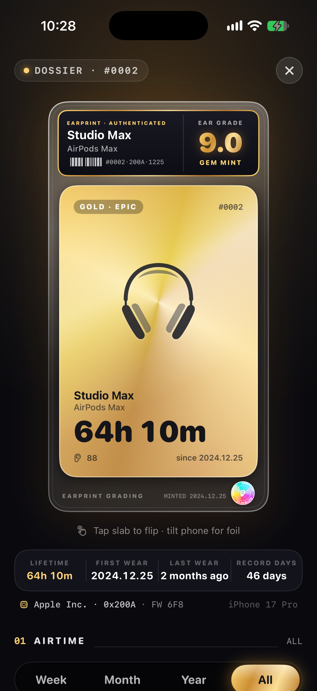 |

| `01` Airtime | `02` Rhythm (Trend) | `02` 24-Hour Clock |
|---|---|---|
| 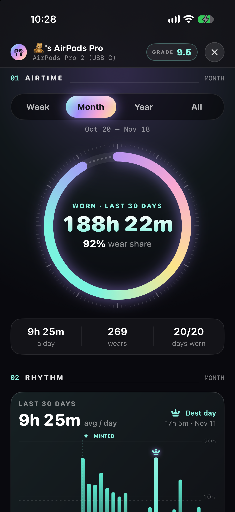 | 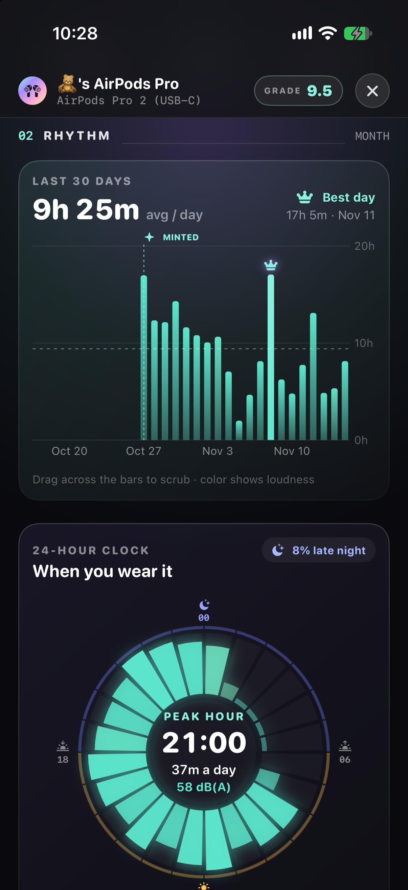 | 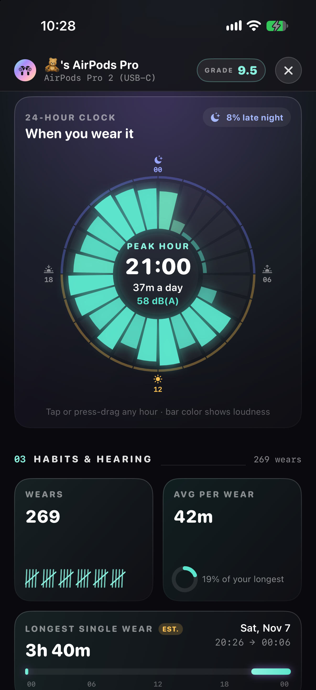 |

| `03` Habits & Hearing | `03` Lifetime Ledger | `04` Milestones | `05` Certificate & Grade |
|---|---|---|---|
| 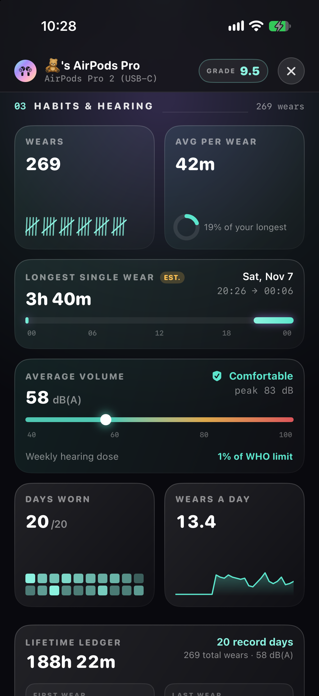 | 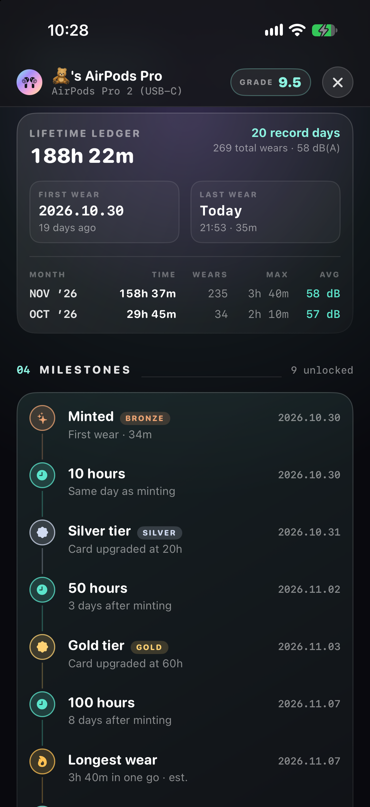 | 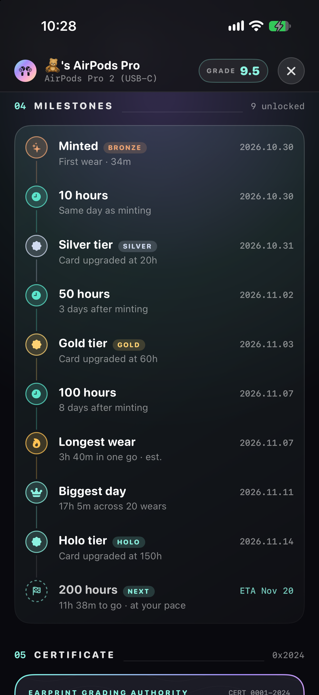 | 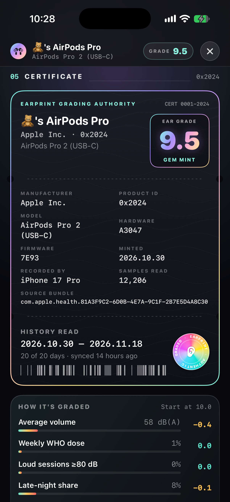 |

---

## HealthKit Data Pipeline Contract

All UI in `Earprint/Dossier/` consumes a single value type, `DeviceDossier` (defined in `Earprint/Dossier/DeviceDossier.swift`). Right now `DeviceDossierView(card:)` defaults to `DeviceDossier.sample(for: card)`; once the HealthKit pipeline is wired up, pass a real `DeviceDossier` into `DeviceDossierView(card: card, dossier: realDossier)`.

### Initializer Inputs

```swift
DeviceDossier(
    id: String,                          // Stable device identifier (matching HeadphoneCard.id)
    nickname: String,                    // HKDevice.name (e.g. "🧸's AirPods Pro")
    symbol: String,                      // SF Symbol name mapped from productID / form factor
    serial: Int,                         // 1-based collection serial order (by first wear)
    hardware: DossierHardware,           // HKDevice + HKSource provenance (see below)
    sessions: [WearSession],             // Merged wear sessions (any order; sorted by start on init)
    otherDevicesDailyMinutes: [Date: Double], // Start-of-day -> minutes worn on OTHER headphones
    sampleCount: Int,                    // Total HKQuantitySample count read for this device
    lastSynced: Date,                    // Timestamp of last completed HealthKit query
    now: Date,                           // Reference "now" (Date() in production)
    calendar: Calendar = .current
)
```

### `WearSession` (Merged from `HKQuantityTypeIdentifier.headphoneAudioExposure`)

| Field | Type | HealthKit Source / Computation |
|---|---|---|
| `start` | `Date` | `startDate` of the first sample in a merged wear session. |
| `minutes` | `Double` | Total duration of the session in minutes (`(end - start) / 60`). |
| `averageDecibels` | `Double` | Energy-averaged loudness in dB(A): `10 * log10(sum(10^(dB_i/10) * dt_i) / sum(dt_i))`. |
| `peakDecibels` | `Double` | Maximum sample value (`HKUnit.decibelAWeightedSoundPressureLevel()`) observed inside the session. |
| `isEstimated` | `Bool` | `true` when session boundaries were bridged/inferred across sample gaps rather than strictly contiguous samples (surfaces the `EST.` pill in the UI). |

### `DossierHardware` (`HKDevice` & `HKSource` Metadata)

| Field | Type | HealthKit Property | Example |
|---|---|---|---|
| `deviceName` | `String` | `HKDevice.name` | `"🧸's AirPods Pro"` |
| `manufacturer` | `String` | `HKDevice.manufacturer` | `"Apple Inc."` |
| `productID` | `String` | `HKDevice.model` (Bluetooth PID) | `"0x2024"` |
| `modelName` | `String` | Local lookup table from `productID` (fallback to `deviceName`) | `"AirPods Pro 2 (USB-C)"` |
| `hardwareVersion` | `String?` | `HKDevice.hardwareVersion` (`nil` renders `"Not reported"`) | `"A3047"` |
| `firmwareVersion` | `String?` | `HKDevice.firmwareVersion` (`nil` renders `"Not reported"`) | `"7E93"` |
| `sourceName` | `String` | `HKSource.name` (usually the recording iPhone) | `"iPhone 17 Pro"` |
| `sourceBundleID` | `String` | `HKSource.bundleIdentifier` | `"com.apple.health.81A3F9C2-…"` |

### Automatically Derived Properties

You do **not** need to pre-compute any charts, totals, or grades in the pipeline — `DeviceDossier.init` computes them deterministically from `sessions` and `otherDevicesDailyMinutes`:

- **`days: [DayStat]`** — Dense daily array from `firstWear` to `now`, slicing cross-midnight sessions into exact per-hour buckets (`hourMinutes[0..<24]`, `hourEnergy[0..<24]`) and adding `otherDevicesDailyMinutes[day]` to compute `allDevicesMinutes` for wear share.
- **`periods: [DossierPeriod: PeriodStats]`** — Pre-aggregated rolling stats for `.week` (7d), `.month` (30d), `.year` (12m), and `.all`, including adaptive `TrendBucket` resolution (`.day` / `.weekOfYear` / `.month`), 24-hour `HourStat` profiles, energy-averaged `averageDecibels`, `peakDecibels`, previous-window `change`, `weeklyDose` (WHO standard: 40h/week at 80 dB(A), halving every +3 dB), and `loudShare` (share of listening in sessions ≥ 80 dB(A)).
- **`grade: EarGrade`** — Starts at `10.0` and deducts four transparent penalties based on the last 30 days (falling back to lifetime):
  1. **Average volume**: `max(0, dB - 55) * 0.12`
  2. **Weekly WHO dose**: `min(3.0, weeklyDose * 2.5)`
  3. **Loud sessions ≥ 80 dB**: `min(2.0, loudShare * 8.0)`
  4. **Late-night share (00:00–05:00)**: `min(0.6, nightShare * 0.8)`
  - Score labels: `9.95+` *PRISTINE*, `9.0+` *GEM MINT*, `8.0+` *MINT*, `7.0+` *NEAR MINT*, `6.0+` *EXCELLENT*, `5.0+` *VERY GOOD*, `<5.0` *WELL WORN*.
- **`milestones: [DossierMilestone]`** — Minted date, cumulative hour marks, rarity tier upgrades (`20h` Silver, `60h` Gold, `150h` Holo), longest wear, biggest day, and pace-projected next target.
- **`careerRows: [CareerRow]`** — Newest-first monthly breakdown (`label`, `minutes`, `sessions`, `longest`, `averageDecibels`).

## File Map

- `Earprint/Dossier/DeviceDossier.swift` — Data model, WHO dose & Ear Grade engine, daily/period/milestone/career aggregators.
- `Earprint/Dossier/DeviceDossier+Sample.swift` — Deterministic sample generator matching `SampleCards`.
- `Earprint/Dossier/DossierStyle.swift` — Palette, formatting helpers, `DossierSectionHeader`, `.dossierTile`, `DossierBarcode`, `HoloSeal`.
- `Earprint/Dossier/DossierSlab.swift` — `GradingSlab`, `CertificateLabel`, `Perforation`, `GradeBreakdown`.
- `Earprint/Dossier/DossierCharts.swift` — `DossierTrendChart` (Swift Charts) and `DayClock` (24-hour radial Canvas).
- `Earprint/Dossier/DossierSections.swift` — `PeriodSwitcher`, `AirtimeHero`, `HabitsBento` (`TallyMarks`, `SessionTrack`, `LoudnessMeter`, `DayDots`, `Sparkline`).
- `Earprint/Dossier/DeviceDossierView.swift` — Main scrollable dossier view, sticky header, lifetime quick strip, `LifetimeLedgerCard`, `MilestoneTimelineCard`, and launch-argument demo controller.
